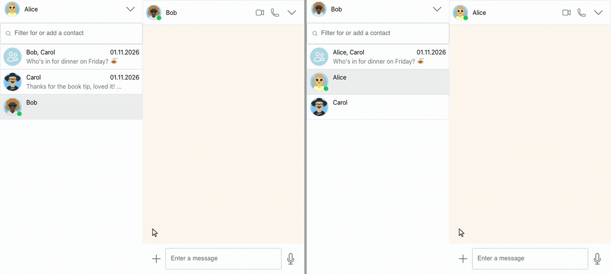

# Florian's Chat - Real-Time Messaging App


[](#)


A WhatsApp-style real-time chat application featuring video/voice calls, group messaging, and end-to-end type safety between frontend and backend.
The complete production environment on Google Kubernetes Engine is reproducible from code: three `terraform apply` runs
and one set of DNS records take an empty GCP billing account to a running, TLS-secured deployment, and every tagged
release after that deploys itself.

---


<sub>Two browsers side by side: typing indicator, live delivery, read receipts and image sharing. Recorded automatically
with Playwright, see [Demo GIF](#demo-gif).</sub>

---

## Architecture Overview

```
┌─────────────────┐         ┌─────────────────┐         ┌─────────────────┐
│     React       │  REST   │     NestJS      │         │    MongoDB      │
│    Frontend     │────────▶│     Backend     │────────▶│    (Mongoose)   │
│   (Vite/MUI)    │◀────────│   (TypeScript)  │         └─────────────────┘
└─────────────────┘         └─────────────────┘
        │                           │                   ┌─────────────────┐
        │      Socket.io            │──────────────────▶│     Redis       │
        └───────────────────────────┘                   │  (WebSocket     │
        │                           │                   │   scaling)      │
        │         WebRTC            │                   └─────────────────┘
        └──────────┬────────────────┘
                   ▼                                    ┌─────────────────┐
          ┌─────────────────┐                           │       S3        │
          │    PeerJS +     │                           │  (File storage) │
          │  Coturn (TURN)  │                           └─────────────────┘
          └─────────────────┘
```

## Tech Stack

### Frontend
- **React 19** with TypeScript and functional components
- **MUI** component library + **Tailwind CSS** for styling
- **Vite** for fast development and optimized builds
- **Socket.io client** for real-time bidirectional communication
- **PeerJS** for WebRTC video/voice calls
- **typesafe-i18n** for internationalization
- Responsive design for mobile and desktop

### Backend
- **NestJS** framework with TypeScript
- **MongoDB** with Mongoose ODM for data persistence
- **Redis** adapter for horizontally scalable WebSocket connections
- **S3** compatible storage for images and audio messages
- **JWT** authentication with secure HTTP-only cookies
- **Bcrypt** password hashing
- Custom **PeerJS server** fork with pub/sub functionality
- Uses an internal **event bus** to decouple its services

### API Design
- **ts-rest** for type-safe API contracts between frontend and backend
- **Zod** schema validation with types shared across the stack
- RESTful endpoints with full TypeScript type inference
- WebSocket events for real-time message delivery and read receipts

### DevOps & Infrastructure
- **Terraform** provisions the entire GCP environment, from project creation to the Helm release
- **Docker** containerization with multi-stage builds
- **GitHub Actions** CI/CD pipeline, authenticated to GCP via **Workload Identity Federation** (no stored keys)
- **Google Kubernetes Engine (GKE)** for container orchestration
- **Traefik** ingress, **cert-manager** with Let's Encrypt wildcard certificates (DNS-01), **Reloader** for certificate rotation
- **Google Cloud Storage** via its S3-compatible API for file uploads in production
- **Helm charts** for declarative Kubernetes deployments:
  - Main application chart with configurable values
  - MongoDB subchart
  - Redis subchart
  - S3Mock subchart for local development
  - Coturn TURN server subchart for WebRTC connectivity
  - Loki + Grafana chart for centralized logging and monitoring
  - GlitchTip chart for error tracking
- **Google Artifact Registry** for Docker image storage

## Features

- User registration, login, and logout with secure password hashing
- Send contact requests, add contacts, send direct messages, or ignore users
- Create group chats with multiple participants
- Real-time message delivery and read receipts
- User profile editing and viewing
- Image sharing
- Audio message recording and playback
- Video and voice calls via WebRTC
- Real-time online status indicators
- Chat cleanup and deletion

## Key Technical Decisions

| Challenge | Solution |
|-----------|----------|
| Scalable WebSockets | Redis pub/sub adapter enables horizontal scaling across multiple backend instances |
| Type-safe API | ts-rest contracts with Zod ensure frontend/backend type consistency at compile time |
| Video calls behind NAT | Self-hosted Coturn TURN server deployed via Helm for reliable WebRTC connectivity |
| File handling | S3-compatible storage with secure access for scalable file uploads |
| Kubernetes deployment | Helm charts with subcharts for modular, reproducible infrastructure |
| Reproducible environments | Terraform provisions project, network, cluster, DNS, storage, secrets and workloads; nothing is configured by hand in the console |
| TLS for a TURN server | coturn needs the private key, which Google-managed certificates never expose, so cert-manager issues a Let's Encrypt wildcard certificate shared by Traefik and coturn |
| Certificates without moving DNS | Only `_acme-challenge` is delegated to a Terraform-managed Cloud DNS zone; the domain stays at its registrar |
| Secrets management | JWT, TURN and storage credentials are generated by Terraform and injected as Kubernetes Secrets; none live in the repository or CI |
| Keyless CI/CD | GitHub Actions exchanges its OIDC token for short-lived GCP credentials, restricted to this repository |
| Observability | Loki + Grafana stack for centralized logging across all services |

## Testing

### Unit tests

```bash
cd backend && npm test
```

### End-to-end tests

The Playwright suite in [`e2e/`](e2e) covers every feature that runs locally, so everything except voice and video calls. It needs no Kubernetes: MongoDB, Redis and an S3 mock come from `local-development/docker-compose.yaml`, and Playwright starts the backend and the Vite dev server itself.

```bash
npm run e2e:infra    # start MongoDB (replica set), Redis and the S3 mock
npm run e2e          # run the suite (starts backend + frontend if they aren't running)
npm run e2e:ui       # interactive UI mode, handy for writing and debugging tests
npm run e2e:headed   # watch the browsers
npm run e2e:report   # open the HTML report of the last run
```

Prerequisites: Docker, Node.js, `backend/.env` created from `backend/.example.env`, and a one-time `npx playwright install chromium`.

How the suite is set up:

- **Isolation**: every test registers its own users through the REST API and signs them into fresh browser contexts, so tests run in parallel and never share data. Real-time features use several users at once.
- **Rate limits**: all test users share one IP, so the backend started by Playwright runs with `E2E_THROTTLE_MULTIPLIER=1000`, which scales all REST and WebSocket rate limits. The variable defaults to `1`, so production limits are unchanged. If you start the backend yourself and let Playwright reuse it, set it there too: `E2E_THROTTLE_MULTIPLIER=1000 npm run start:backend`.
- **Projects**: `chromium` (with a fake microphone for audio messages) runs everything except `responsive/`, which runs in `mobile-chromium` (Pixel 7). `E2E_ALL_BROWSERS=1` adds Firefox, which skips tests tagged `@chromium-only`.
- **Debugging**: failed tests keep a screenshot and an `error-context.md` with the page snapshot in `test-results/`. On CI, the first retry also records a trace (`npx playwright show-trace <trace.zip>`).

### Demo GIF

The GIF at the top is generated, not screen-recorded, so it can be refreshed after every UI change:

```bash
npm run e2e:infra    # same infrastructure as the e2e suite
npm run demo:gif     # records the scene and writes imgs/demo.gif (needs ffmpeg)
```

[`demo/demo.spec.ts`](demo/demo.spec.ts) reuses the e2e page objects to drive two signed-in users, and
[`demo/make-gif.sh`](demo/make-gif.sh) trims both recordings to the scene and puts them side by side with ffmpeg.

## CI/CD Pipeline

The project uses GitHub Actions for continuous deployment:

1. **Trigger**: Pipeline runs on tagged commits
2. **Authenticate**: Short-lived GCP credentials via Workload Identity Federation, no service account key
3. **Build**: Docker image built with Vite environment variables
4. **Push**: Image pushed to Google Artifact Registry with version tag
5. **Deploy**: `terraform apply` of the Kubernetes layer with the new image tag, so Terraform remains the single source of truth for what runs in the cluster

See [`.github/workflows/release.yaml`](.github/workflows/release.yaml) for the full pipeline.

## Helm Charts

The `helm/` directory contains multiple charts for deploying the entire stack:

```
helm/
├── realtime-chat/       # Main application
│   ├── charts/
│   │   ├── coturn/      # TURN server for WebRTC
│   │   ├── mongodb/     # Database
│   │   ├── redis/       # WebSocket scaling
│   │   └── s3mock/      # Local S3 emulation
│   └── values.yaml
├── loki-grafana/        # Logging and monitoring
└── glitchtip/           # Error tracking
```

## Infrastructure as Code

The whole GKE environment is provisioned with Terraform, split into three roots that are applied in order:

```
terraform/
├── bootstrap/   # GCP project, enabled APIs, remote state bucket   (local state)
├── infra/       # VPC, GKE cluster, static IPs, Cloud DNS zone,     (state in GCS)
│                #   Artifact Registry, GCS bucket + HMAC key,
│                #   GitHub OIDC trust, generated secrets
└── k8s/         # Traefik, cert-manager, Reloader, wildcard          (state in GCS)
                 #   certificate, the realtime-chat Helm release
```

Splitting `infra` and `k8s` lets the Kubernetes and Helm providers be configured from a cluster that already exists,
and keeps routine deployments (which only touch `k8s`) away from the cluster and network.

### Deploying from scratch

```bash
# 1. Project and state bucket
cd terraform/bootstrap && terraform init && terraform apply

# 2. Cluster and cloud resources
cd ../infra && terraform init -backend-config="bucket=<tfstate_bucket>" && terraform apply
terraform output namecheap_records   # add these DNS records once at the registrar

# 3. Platform and application
cd ../k8s && terraform init -backend-config="bucket=<tfstate_bucket>" && terraform apply
```

After that, every tagged commit is built and deployed by GitHub Actions. Static IPs are reserved before anything is
deployed, so DNS can be set up front, and certificates are issued and renewed without manual steps.

See [`terraform/README.md`](terraform/README.md) for the full walkthrough, TLS design, troubleshooting and teardown.
